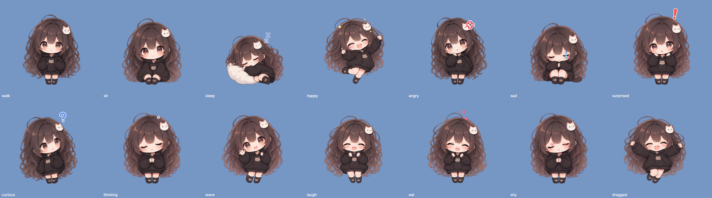
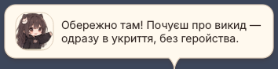
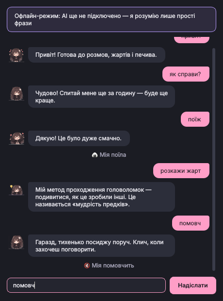
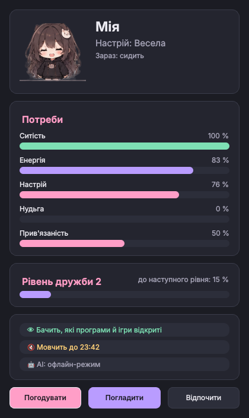

# Chibi AI Companion

Маленька chibi-дівчина **Мія**, яка живе на робочому столі Windows 10/11: гуляє
вздовж панелі завдань, сідає, засинає від нудьги, реагує на твої ігри та
програми (лише з твого дозволу), розмовляє українською — текстом і голосом,
має потреби тамагочі, пам'ятає те, що ти їй розповідаєш, і грає з тобою в
міні-ігри.

Її можна зробити **голосовим компаньйоном**: вона слухає без кнопок і
відповідає, коли до неї звертаються на ім'я, має характер, описаний твоїми
словами, бачить вікно, у якому ти працюєш чи граєш, і сама вирішує, коли
варто щось сказати, — як людина, що сидить поруч і дивиться. Усе це
вимкнено за замовчуванням і вмикається окремими дозволами — див.
[«Голосовий компаньйон»](#голосовий-компаньйон-фаза-6).

> **Версія 0.9.0 — шість фаз реалізовано.** Це «реліз-кандидат»: логіка
> перевірена тисячами тестів і на справжній Windows у CI, але частину речей
> (звук, постійно відкритий мікрофон, захоплення вікон, прозорість на твоєму
> робочому столі) можна перевірити лише на живому ПК — див.
> [«Що перевірено, а що ні»](#що-перевірено-а-що-ні). 1.0 — після цієї перевірки.



<p>

</p>
<p>


</p>

*Скриншоти зроблені автоматично в headless-режимі (Linux), тому фон умовний.*

## Встановлення (Windows 10/11)

### Варіант 1 — інсталятор (рекомендовано)

Інсталятор збирає GitHub Actions при кожному оновленні гілки:

1. Відкрий вкладку **Actions** репозиторію → останній зелений запуск **tests** →
   внизу сторінки **Artifacts** → **ChibiCompanion-windows** (потрібно увійти в
   GitHub; артефакт зберігається 14 днів).
2. Розпакуй завантажений ZIP і запусти `ChibiCompanion-Setup-<версія>.exe`.
   Права адміністратора не потрібні — програма ставиться лише для тебе
   (`%LOCALAPPDATA%\Programs\ChibiCompanion`), з ярликом у меню «Пуск» і,
   за бажанням, автозапуском разом із Windows.
3. Windows SmartScreen може попередити «Невідомий видавець» — інсталятор не
   підписаний сертифікатом (це платна послуга). «Докладніше → Усе одно запустити».

Голосові бібліотеки (Whisper, onnxruntime, sounddevice) уже всередині
інсталятора; самі **моделі голосу** завантажуються окремо зі сторінки
«Налаштування → Голос» (див. нижче).

Якщо захочеш, щоб інсталятор з'являвся на сторінці **Releases** (без входу в
GitHub), — це можна додати окремим кроком збірки за тегом версії.

### Варіант 2 — із вихідного коду

1. Встанови **Python 3.12 або новіший** з <https://www.python.org/downloads/>
   (постав галочку **«Add python.exe to PATH»**).
2. Завантаж репозиторій (`Code → Download ZIP` або `git clone`).
3. Двічі клацни **`setup.bat`** — створиться віртуальне середовище й
   встановляться залежності разом із голосовими (~300 МБ, один раз).
4. Двічі клацни **`run.bat`** — Мія з'явиться внизу праворуч над панеллю завдань.

`run_debug.bat` запускає те саме з консоллю й докладним журналом.
`ChibiCompanion.exe --self-test` (або `python -m chibi --self-test`) перевіряє
встановлення: ресурси, дані, база, бібліотеки голосу.

## Що вона вміє

### Персонаж і тамагочі (фаза 1, 5)

* Прозоре вікно без рамок, завжди поверх (вимикається), **ніколи не забирає
  фокус**. Ходить уздовж панелі завдань, сідає, спить, озирається на курсор,
  махає, потягується, підстрибує, танцює, радіє, пишається собою —
  **26 станів**, 29 анімацій зі спрайтів, ефекти (💢, сльозинка, сердечка, Zzz),
  «присідання» після приземлення.
* Перетягування з гравітацією, кілька моніторів і різний DPI, Ctrl + коліщатко —
  масштаб, «закріпити позицію», «пропускати кліки крізь неї».
* **Тамагочі**: ситість, енергія, настрій, нудьга, прив'язаність, рівень дружби.
  **Ніколи не карає за відсутність**: поки програма закрита, вона «спить»;
  голод і нудьга не виходять за м'які межі, хоч би тебе не було тиждень.
* **Подарунки**: щодня +5 ⭐ за перший запуск, зірочки — за міні-ігри
  (з денною межею). У крамничці 10 подарунків — від яблука до навушників:
  їжа й напої впливають на потреби, сувеніри вона зберігає назавжди й
  згадує в розмові.
* **Міні-ігри**: «Камінь-ножиці-папір», «Лови печиво», «Вгадай число» —
  вона коментує результат, радіє за тебе й не зловтішається.

### Розмова й характер (фаза 2)

* **875 готових реплік українською** у 141 ситуації — працюють без інтернету й
  без AI. Тон залежить від слайдерів характеру (гумор, сарказм,
  прив'язаність, балакучість…), репліки не повторюються.
* **AI-мозок** (необов'язково): Claude (Anthropic), будь-який OpenAI-сумісний
  сервер (OpenAI, LM Studio, llama.cpp…) або **Ollama на твоєму ПК**.
  **Правила вирішують, *коли* вона говорить, модель — лише *як***: AI не може
  засипати тебе репліками, а без нього все працює з банку реплік.
* **Чат** зі стрімінгом відповіді. Попросиш «поїж», «помовч», «йди спати» —
  виконає, але лише якщо про це справді було прохання (захист від того, що
  модель «вигадає» дію).
* **Пам'ять**: запам'ятовує факти, які ти розповідаєш їй у чаті (ім'я,
  улюблені ігри…), і доречно згадує їх. Голосом — лише з того, що сказано їй
  на ім'я чи клавішею: почуте без імені (телевізор, інші люди поруч) не
  запам'ятовується. Все видно й редагується в «Налаштування → Пам'ять»;
  паролі, ключі, номери карток не зберігаються навіть якщо ти їх напишеш.
* **Емоції** (цікавість, збудження, довіра…) й автономні рішення: сама
  запропонує перерву після довгої гри, згадає щось про тебе, позіхне ввечері.
* **Ліміти витрат**: запитів за годину/день, долари на день (жорстка межа),
  тайм-аути; кешування, щоб не платити двічі за те саме.

### Ігри й бачення екрана (фаза 3)

* Розпізнає запуск і завершення **85 відомих ігор** (і невідомі — за теками
  Steam/Epic/GOG), веде статистику ігрових сесій.
* **Бачення екрана** (вимкнене за замовчуванням): дивиться на **одне вікно на
  передньому плані** — лише з ігор і програм зі списків, які складаєш ти, або
  (окремою згодою) на будь-яке вікно, крім приватних і системних. Ніколи — на
  весь робочий стіл, інші монітори чи приватні програми. Режими: вимкнено /
  «лише коли попрошу» / автоматично / лише в іграх.
* Реагує на події в грі (загибель, перемога, бій з босом, нова локація,
  досягнення…) — лише коли подія підтверджена двома кадрами, з кулдаунами,
  лімітом реакцій на годину й без спойлерів (якщо не дозволиш).
* «Подивись на екран» у меню або чаті — коротко скаже, що бачить. Якщо не може
  (немає дозволу, немає моделі із зором), чесно скаже чому, а не вигадає.
* **Ігровий компаньйон**: під час гри — менше хмаринок; якщо ввімкнено голос,
  коментарі звучать голосом без тексту поверх гри.

### Голос (фаза 4)

* **Голос Мії**: Piper — локально, без інтернету (жіночі голоси Тетяна, Лада;
  є й чоловічий), або Azure Neural (хмара, Поліна/Остап, потрібен свій ключ).
  Числа, час, назви ігор латиницею вимовляються по-українськи
  («S.T.A.L.K.E.R. 2» → «сталкер два»).
* **Розпізнавання мови**: Whisper — **локально на твоєму ПК**, звук нікуди не
  надсилається й не записується.
* **Push-to-talk**: глобальна клавіша (за замовчуванням `Ctrl+Alt+Space`,
  можна змінити) у режимі «натиснув — говориш — пауза» або «рація» (тримаєш).
  Без перехоплення клавіатури: використовується `RegisterHotKey`.
* Розмова без кнопок — звертання на ім'я, відповіді речення за реченням —
  див. [«Голосовий компаньйон»](#голосовий-компаньйон-фаза-6).
* Анімація говоріння синхронізована зі звуком, тицьнеш у неї — замовкне.

### Голосовий компаньйон (фаза 6)

Як голосовий режим ChatGPT, але локальний і з очима: говориш вголос — вона
відповідає голосом; бачить твоє вікно й інколи сама щось каже. Усе нижче
вимкнено за замовчуванням.

**Як вона слухає** («Налаштування → Голос → Як слухати»):

| Режим | Як працює | Чесно про мінуси |
|---|---|---|
| **Клавіша або кнопка мікрофона** | мікрофон вмикається лише на час фрази (push-to-talk) | треба натискати |
| **Постійно, коли звертаюся на ім'я** (рекомендовано) | мікрофон відкритий, поки вона мовчить; «Міє, котра година?», «Як справи, Міє?» — і вона відповідає, а далі розмова триває без імені (повзунок «Розмова без імені», 0–120 с) | може відгукнутися на своє ім'я з телевізора чи чужої розмови; незвичні імена краще казати на початку фрази |
| **Постійно — усе, що вона чує, для неї** | кожна почута фраза — для неї | відповідає й на телевізор, музику, інших людей поруч; з платним AI кожна фраза — окремий запит |

* **Розпізнавання локальне** (Whisper на твоєму ПК): звук не записується й
  нікуди не надсилається. До AI потрапляє лише текст того, що сказано їй
  (з хмарним AI — у хмару).
* Поки мікрофон відкритий — **червона крапка в треї**. Мікрофон сам стає на
  паузу, коли: увімкнено «Не турбувати»; на передньому плані приватна
  програма (завжди); програма для дзвінків — Discord, Telegram, Zoom тощо
  («Не слухати під час дзвінків»); гра на весь екран (якщо не ввімкнено
  «Слухати й у грі на весь екран»). Дзвінок у фоні (програма для дзвінків не
  на передньому плані) мікрофон сам не помітить. Будь-коли — **«Пауза
  мікрофона»** в її меню й у треї: вона діє, доки її не знято, і після
  перезапуску теж. Чому мікрофон на паузі, видно в підказці значка в треї.
  Клавіша розмови працює завжди.
* Ім'я рахується лише окремим словом, а схоже слово («вікно» для Віки,
  «мама» для Маші) — ні. Можна покликати її, помовчати й лише тоді сказати
  прохання: наступна фраза однаково для неї («Міє, … котра година?»).
* Відповідь AI вона починає казати **з першого готового речення**, поки модель
  дописує решту; у чаті й у хмаринці відповідь з'являється рівно один раз.
* Чесно: це **не дуплекс**. Поки вона говорить, мікрофон закритий (щоб вона не
  чула себе), тож перебити її голосом не вийде — клацни на неї або натисни
  клавішу розмови. Затримка — розпізнавання (1–3 с на процесорі для `small`) +
  перше речення моделі + синтез. Фрази розпізнаються по одній: сказане, поки
  вона ще розпізнає попереднє, пропускається (крім фрази одразу після її
  імені). Свої репліки вона не вставляє між реченнями відповіді, а на її
  запитання можна відповісти без імені. Якщо ти заговориш, поки вона ще
  відповідає, нове прохання дочекається кінця відповіді (лише останнє).
  Відкритий мікрофон у галасливій кімнаті частіше вмикає розпізнавання —
  більше навантаження на процесор.

**Характер своїми словами** («Налаштування → Характер»): до 1500 символів —
вдача, манера говорити, захоплення, історія, ставлення до тебе; є готові
заготовки («Турботлива подруга», «Дотепна геймерка», «Спокійна наставниця»,
«Фанатка аніме»). Опис важливіший за повзунки характеру, але її базові
правила завжди сильніші: українська, чесність (не вдає, що бачить чи вміє те,
чого не може), безпека даних, формат відповіді. Працює **лише з AI**: без
нього вона відповідає готовими репліками. З хмарним AI опис надсилається
провайдерові з кожним запитом. Маленькі локальні моделі тримаються опису
гірше за великі.

**Бачить будь-яке вікно** («Бачення екрана → Що вона може бачити → Будь-яке
вікно на передньому плані, крім приватних», окрема згода): гра, код,
документ, відео — лише **одне вікно на передньому плані**, ніколи весь екран
чи інші монітори. Пропускає: свої вікна; приватні програми (менеджери
паролів, месенджери, пошта, банкінг, твої винятки); системні вікна Windows
(екран блокування, «Пуск», диспетчер завдань, запити UAC, вибір файлів);
браузер — лише з дозволом «Читати заголовки вікон» (щоб розпізнати й
пропустити приватні вкладки, банкінг і пошту). Листування (чати, пошту) вона
ніколи не переказує, а з опису прибираються адреси, номери й посилання.
Кадри аналізуються лише в пам'яті.

**Режим спостерігача** («Бачення екрана → Як коментувати → Як спостерігач»,
потрібен AI): вона веде короткий журнал того, що бачила (до 10 моментів за
15 хвилин, лише в пам'яті), і час від часу питає модель, чи є що сказати.
Здебільшого відповідь — тиша. Говорить не частіше ніж раз на 2–10 хвилин
(залежить від частоти коментарів і балакучості), робить не більше 6–20 таких
запитів на годину й мовчить, коли тебе немає за ПК (розмова голосом
рахується як присутність), коли ти говориш із нею, коли увімкнено «Не
турбувати» чи тихий режим. Каже лише про те, що справді бачила модель зору:
смерть чи перемогу — лише після другого кадру, а відповідь із числами чи
латинськими словами, яких не було в побаченому (чи в описі її характеру),
відкидається. Якщо сама вона зараз нічого сказати не може (вимкнено «Формулювати
через AI її власні репліки», AI недоступний, ліміт), сторінка пише чому, а
кадрів вона тоді не знімає. З хмарним голосом Azure її слова про екран
озвучуються лише з дозволом «Хмарний аналіз екрана» — інакше вона їх пише. У режимі «Лише помітні події в іграх» вона, як і
раніше, реагує тільки на яскраві моменти гри.

**Скільки це коштує з Claude** (оцінка за цінами з таблиці програми; точні
витрати за день — на сторінці «AI»):

* Один проаналізований кадр — приблизно **1,5–2 тис. вхідних токенів**
  (зображення до 1024 px ≈ 0,8–1,4 тис. + інструкція) і 100–200 вихідних:
  `claude-opus-5-5` ≈ **1 цент**, `claude-sonnet-5-5` ≈ 0,5 цента,
  `claude-haiku-5-5` ≈ 0,03 цента.
* В автоматичному режимі з інтервалом 30 с це могло б бути до 120 кадрів на
  годину, але зір бере щонайбільше **половину годинного ліміту запитів до
  AI** (за замовчуванням 30 із 60), щоб чатові й спостерігачеві завжди
  лишалося місце; вичерпавши свою частку, він робить паузу й каже про це. Тож
  з Opus — до ~$0,3–0,4 на годину, з Haiku — близько цента. Однакові кадри
  вдруге не аналізуються, а в режимі «будь-яке вікно» на статичному екрані
  пауза довшає, і поки тебе немає за ПК, кадрів немає, тож зазвичай виходить
  менше. Більше кадрів — збільш «Запитів за годину» на сторінці «AI».
* Рішення спостерігача — ще до 6–20 запитів на годину, кожен ≈ 3–5 тис.
  вхідних токенів (з Opus ≈ 1–2,5 цента; здебільшого відповідь — коротка
  «тиша»).
* Денний ліміт у доларах (за замовчуванням $1) спільний для чату, зору й
  спостерігача: з Opus для зору його вистачить приблизно на годину. Тому для
  зору вкажи дешевшу модель («Окрема модель для зору», наприклад
  `claude-haiku-5-5`) або збільш інтервал.
* **Локальні моделі** безкоштовні, але для зору потрібна модель, що бачить
  зображення (`gemma3`, `qwen2.5vl`, `llava` в Ollama), і **відеокарта**: на
  процесорі один кадр аналізується десятки секунд. Модель на тій самій
  відеокарті, що й гра, забирає відеопам'ять і FPS.

**З локальною моделлю** все це теж працює: характер — так (краще з моделлю від
7–8B), постійна розмова голосом — так (розпізнавання й голос однаково
локальні), бачення вікон — лише з моделлю, що бачить зображення, і з
відеокартою. Назви активних програм вона знає й без жодної моделі — з
дозволом «Бачити назви активних програм та ігор».

## Налаштування після встановлення

### 1. Перший запуск

Майстер першого запуску спитає ім'я, як до тебе звертатися, і чи дозволяєш
бачити назви програм. Усі дозволи можна змінити пізніше в
«Налаштування → Приватність».

### 2. AI (необов'язково) — «Налаштування → AI»

| Варіант | Що потрібно | Якість української | Вартість |
|---|---|---|---|
| **Claude** (рекомендовано) | API-ключ з <https://console.anthropic.com>, дозвіл «Хмарний AI» | відмінна | платно за запити; денний ліміт у доларах (за замовчуванням $1) |
| **OpenAI-сумісний** | ключ OpenAI або адреса локального сервера (LM Studio, llama.cpp) | залежить від моделі | OpenAI — платно; локальний — безкоштовно |
| **Ollama** (локально) | встановлена [Ollama](https://ollama.com) і модель | залежить від моделі | безкоштовно, працює без інтернету |

**Чесно про локальні моделі.** Я перевірив увесь ланцюжок на справжній
локальній моделі 1,5B: технічно все працює, але **українська в моделей
до ~3B погана** (граматика, вигадані факти). Для живої розмови українською
бери **Claude** або локальну модель **від 7–8B** (наприклад, `gemma3:12b`,
`qwen2.5:7b` в Ollama) — і відповідно потужну відеокарту. Для бачення екрана
потрібна модель, що бачить зображення (Claude; в Ollama — `gemma3`, `llava`).

**Скачана модель (GGUF).** Програма не відкриває файл моделі сама — вона
підключається до локального сервера, який модель запускає:

* **Ollama**: для свого `.gguf` створи `Modelfile` з рядком
  `FROM C:\models\назва.gguf`, виконай `ollama create mia-model -f Modelfile`,
  потім «AI → Ollama → Оновити список».
* **LM Studio**: завантаж модель, запусти локальний сервер; у програмі —
  «OpenAI-сумісний», адреса `http://localhost:1234/v1`, ключ не потрібен.
* **llama.cpp**: `llama-server -m model.gguf --port 8080 -c 8192` → адреса
  `http://localhost:8080/v1`.

Сервер на `localhost` не потребує дозволу «Хмарний AI» — нічого не залишає
ПК. Потрібна саме чат-модель (Instruct), контекст — від 8192 токенів; на
слабкому ПК збільш «Тайм-аут». «Міркувальні» моделі (Qwen3, DeepSeek-R1,
QwQ) підтримуються — блоки `<think>…</think>` вона не показує й не озвучує, —
але вони повільні й часто витрачають ліміт коротких реплік на роздуми, тож
реакції тоді беруться з банку. Для компаньйона краще звичайні моделі (Gemma 3,
Qwen2.5, Mistral Nemo). Пам'ятай: локальна модель на тій самій відеокарті, що
й гра, забирає відеопам'ять і FPS.

API-ключі зберігаються в **диспетчері облікових даних Windows**, не у файлах
програми й не в журналах.

### 3. Голос — «Налаштування → Голос»

1. Натисни **«Завантажити»** біля моделей: голос Piper (77 МБ) і
   розпізнавання Whisper — `small` (486 МБ, рекомендовано), `base` (148 МБ,
   швидша, але гірше розуміє українську) або `medium` (1,5 ГБ, найточніша,
   повільна на процесорі). Моделі зберігаються в
   `%LOCALAPPDATA%\ChibiCompanion\models`, кожен файл перевіряється за
   SHA-256; завантаження продовжується з місця обриву.
2. Увімкни «Голос Мії» та/або «Розпізнавання мови», дозволь мікрофон
   (окрема згода), вибери клавішу. «Прослухати» — перевірка голосу.
3. «Як слухати» — клавіша, «постійно, коли звертаюся на ім'я» чи «постійно —
   усе, що вона чує, для неї». Відкритіший режим спершу пояснить, що змінюється, і спитає
   згоди. Тут же — «Розмова без імені», «Не слухати під час дзвінків» і
   «Слухати й у грі на весь екран».

### 4. Бачення екрана — «Налаштування → Бачення екрана»

Вибери режим і що вона може бачити: ігри й програми зі списків (додай їх) або
будь-яке вікно на передньому плані, крім приватних. Надай дозвіл «Бачити
вікна ігор і програм»; якщо модель хмарна — ще й окремий дозвіл «Хмарний аналіз
екрана». «Як коментувати»: лише помітні події в іграх або як спостерігач.
Можна вказати окрему, дешевшу модель для зору й увімкнути «Лише локальний
аналіз».

### 5. Характер — «Налаштування → Характер»

Повзунки (гумор, сарказм, балакучість…) і «Характер своїми словами» — опис або
одна із заготовок. Опис діє лише з AI.

## Як із нею взаємодіяти

| Дія | Що станеться |
|-----|--------------|
| Клацнути | «Тицьнути» — відреагує (якщо часто — образиться 🙂). Спить — прокинеться. Говорить — замовкне |
| Перетягнути | Висить і бовтає ногами; відпустиш — впаде на панель завдань |
| Права кнопка | Поговорити, Покликати, Погладити, Погодувати, Сказати голосом, Подивитися на екран, Пограти, Подарунки, Стан, Налаштування, Не турбувати, Пауза мікрофона, Зупинити спостереження, Вийти |
| Ctrl + коліщатко | Більша / менша |
| Клавіша розмови | Слухає тебе (у треї — червона крапка, поки мікрофон відкритий) |
| «Міє, …» вголос | У режимі «постійно, коли звертаюся на ім'я»: відповідає, далі розмова триває без імені |
| Значок у треї | Показати/сховати, міні-ігри, крамничка, «Не турбувати», «Пауза мікрофона», «Пропускати кліки крізь неї», «Заблокувати позицію», приватність; підказка — чи спостерігає, чи слухає і чому мікрофон на паузі |

## Приватність

* **За замовчуванням нічого не відстежується й нічого не надсилається.**
  Кожна можливість — окремий дозвіл з поясненням, що саме відбувається:
  назви програм; заголовки вікон; знімки вікна на передньому плані; хмарний аналіз
  екрана; мікрофон; хмарний AI.
* **Приватні програми виключені** ще до того, як щось потрапить у програму:
  менеджери паролів, месенджери, пошта, банкінг, приватні вкладки браузера.
  Можна додати свої винятки.
* **Без кейлогінгу**: читається лише *скільки часу* миша й клавіатура
  лежать без діла; гаряча клавіша — через `RegisterHotKey`, без хуків.
* **Кадри екрана ніколи не зберігаються**: аналізуються в пам'яті й
  відкидаються; у пам'ять потрапляє хіба що підсумок сесії («S.T.A.L.K.E.R. 2:
  3 смерті, 1 перемога»). Її власні вікна виключені із захоплення.
* **Звук не записується й не надсилається**: розпізнавання локальне, також у
  режимах постійного слухання. Мікрофон відкритий — червона крапка в треї;
  приватна програма на передньому плані — мікрофон на паузі завжди.
* Що бачить хмарний AI: твої повідомлення й сказане їй голосом (як текст), її
  ім'я, характер (разом із твоїм описом) і настрій, назва активної програми
  (якщо дозволено) і доречні спогади. Кадри екрана й короткі описи того, що
  вона бачила, — лише з окремим дозволом «Хмарний аналіз екрана».
* **«Зупинити спостереження»** у меню й треї миттєво відкликає всі дозволи на
  спостереження: програми, заголовки, екран, мікрофон (хмарний AI для чату
  вимикається окремо, у «Приватності»). Зелене «око» в треї — йде спостереження, червона
  крапка — відкритий мікрофон; у підказці треї видно, на яке вікно вона дивиться.
* **Видалення**: «Налаштування → Приватність → Видалити історію / Видалити всі
  дані» (разом із журналами, пам'яттю й API-ключами).
* Без телеметрії. Мережа використовується лише для обраного тобою AI, Azure-
  голосу та завантаження моделей.

Дані: `%APPDATA%\ChibiCompanion\` (`chibi.db` — SQLite, `logs\chibi.log`),
моделі голосу — `%LOCALAPPDATA%\ChibiCompanion\models`. У журнал не потрапляють
тексти чату, розпізнана мова, заголовки вікон, ключі (журнали додатково
проходять фільтр, що маскує схожі на ключі рядки).

## Що перевірено, а що ні

Розробка велася в Linux-контейнері; Windows — лише в CI (GitHub Actions,
windows-latest) без інтерактивного робочого столу. Чесно:

* **Перевірено автоматичними тестами** (~4900, headless): уся логіка
  персонажа, тамагочі, реакцій, бюджетів, приватності, пам'яті, AI-шару
  (провайдери на підставних серверах), голосового конвеєра, бачення,
  міні-ігор і подарунків, вікна налаштувань.
* **Перевірено на справжніх рушіях**: українська озвучка Piper → розпізнавання
  Whisper (коло «сказала → почула»), голосовий сервіс з реальними моделями;
  AI-ланцюжок на справжній локальній LLM (саме звідти — захисти від вигаданих
  дій і спогадів).
* **Перевірено в CI на справжній Windows**: Win32-виклики (активне вікно,
  бездіяльність), захоплення вікна `PrintWindow`, реєстрація гарячої клавіші,
  збірка `.exe`, самоперевірка і запуск/вихід зібраної програми, інсталятор.
* **Не перевірено — потребує твого ПК**: прозорість і клік крізь прозорі
  ділянки, те, що вона не забирає фокус; приховування під час повноекранних
  ігор; справжні мікрофон і динаміки; постійно відкритий мікрофон (як часто
  вона помилково відгукується на ім'я з телевізора, як працює з фоновим шумом,
  навантаження на процесор); як справжні моделі (Claude, локальні) тримаються
  опису характеру, розпізнають робочі вікна й наскільки часто спостерігач
  мовчить; системні вікна Windows у режимі «будь-яке вікно» (назви процесів
  перевірено лише за документацією); захоплення вікон конкретних ігор
  (DirectX/Vulkan, exclusive fullscreen може давати чорний кадр — тоді вона
  про це скаже); Azure-голос із реальним ключем; Claude/OpenAI з реальним
  ключем; кілька моніторів зі змішаним DPI; споживання CPU на Windows.

Якщо щось поводиться не так — запусти `run_debug.bat` (або програму з
`--debug`) і надішли `%APPDATA%\ChibiCompanion\logs\chibi.log`.

## Відомі обмеження

* **Захоплення через `PrintWindow`**, а не Windows Graphics Capture: простіше
  й без додаткових залежностей, але деякі ігри з апаратним прискоренням
  віддають чорний кадр. Вона це розпізнає й не вигадує, що бачить.
* Під час **exclusive-fullscreen** гри вона ховається (оверлей поверх неї
  неможливий без ін'єкцій у гру, яких ми свідомо не робимо) — з голосом вона
  все одно коментує.
* Без AI чат розуміє лише прості фрази (правила; ~12 % помилок на нових
  формулюваннях). З AI — повноцінна розмова.
* Голосова розмова — по черзі, не дуплекс: поки вона говорить, вона не чує
  (перебити — клацнути на неї чи натиснути клавішу розмови). Програму для
  дзвінків у фоні вона не помічає — лише на передньому плані; під час дзвінка
  поверх гри став мікрофон на паузу з меню.
* Спостерігач не розуміє, що відбувається між кадрами, і бачить лише те, що
  розпізнала модель зору; імена людей на екрані фільтр описів прибрати не може
  (лише адреси, номери, посилання й шляхи до файлів).
* Розпізнавання на процесорі: `small` — 1–3 с на фразу; на слабкому ПК бери
  `base`.
* Кадри анімацій — окремі пози з аркушів, не плавні проміжні кадри; плавність
  додають кросфейди й процедурний рух. Live2D — можливе майбутнє розширення.
* Інсталятор не підписаний (SmartScreen попереджатиме).

## Персонаж і анімації

Спрайти зроблені з аркушів власника (`animation.rar`) інструментом
[`tools/build_sprites.py`](tools/build_sprites.py) — 59 кадрів і 27 портретів,
подробиці в [`ASSETS.md`](src/chibi/assets/characters/mia/ASSETS.md). Якщо
спрайти не завантажаться, працює запасний векторний персонаж.

Щоб додати анімації: аркуші **4×2 на полотні 1536×1024 з прозорим фоном,
однаковим розміром персонажа й ногами на одній лінії**, потім

```powershell
pip install -e .[dev]
python tools/build_sprites.py --src <тека з PNG> --out src/chibi/assets/characters/mia
```

## Розробка

```bash
pip install -e ".[dev,voice]"
pytest            # ~4900 тестів, headless (QT_QPA_PLATFORM=offscreen)
ruff check src tests tools
pip install pyinstaller && pyinstaller packaging/ChibiCompanion.spec --noconfirm
```

Архітектура й контракти модулів — [`docs/ARCHITECTURE.md`](docs/ARCHITECTURE.md),
план і статус фаз — [`PLAN.md`](PLAN.md).

## Ліцензії

Код програми — власницький (усі права застережено). Сторонні компоненти:
PySide6 (LGPL, динамічне під'єднання), голоси Piper (MIT, датасет CC0), моделі
Whisper (MIT), faster-whisper / CTranslate2 (MIT), onnxruntime (MIT),
sounddevice (MIT). GPL-пакет `piper-tts` свідомо не використовується.
Персонаж — оригінальні зображення власника проєкту.
